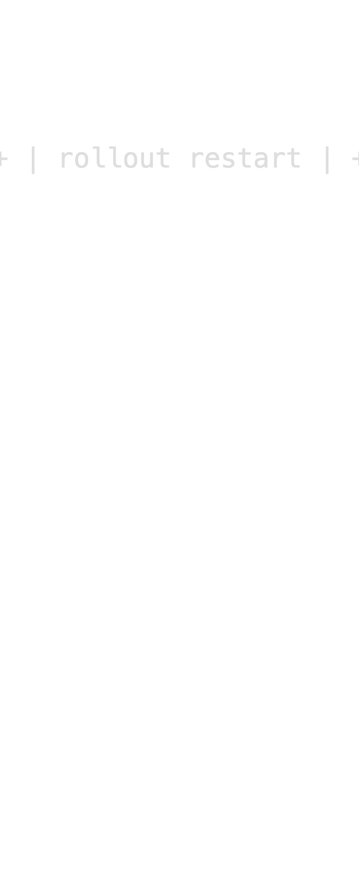
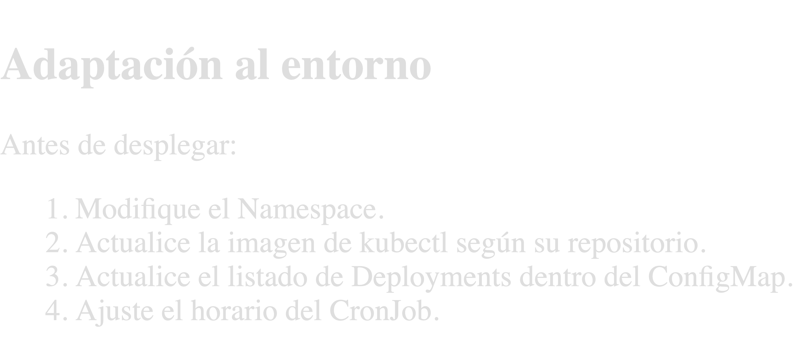

# Rollout Restart de Deployments mediante CronJob

## Objetivo

Automatizar el reinicio periódico de uno o varios Deployments utilizando un CronJob de Kubernetes.

## Recursos utilizados

- ServiceAccount
- Role
- RoleBinding
- ConfigMap
- CronJob

## Flujo

CronJob
↓
Lee ConfigMap
↓
Obtiene lista de Deployments
↓
Ejecuta rollout restart
↓
Kubernetes crea nuevos Pods

## Casos de uso

- Reiniciar aplicaciones legacy.
- Renovar conexiones.
- Aplicar configuraciones cargadas al inicio.
- Reinicios programados fuera de horario productivo.

## Validaciones

# Ver CronJob:

- kubectl get cronjob -n demo-app

# Ver Jobs

- kubectl get jobs

# Ver Pods

- kubectl get pods

# Ver eventos

- kubectl describe cronjob deployment-rollout-restart

